# 外部プロジェクトの文書生成試行

これは公開可能な検証専用プロジェクトの文書原本です。実案件の成果や人間の承認を示すものではありません。

## 確認すること

文書本文と画像は利用側の `docs/` が所有し、共通cloneのテンプレートとCSSを参照してHTMLを作ります。

## 判断待ちの範囲

- 固定SHAのclone参照と単体HTMLをIssue #3の候補にするか。
- PoCの結果は実行ログで確認し、このサンプル本文を検証成功の根拠にしない。
- 全形式対応、実案件での有用性、人間の採用判断は未確認。

## 入力と出力

| 所有者 | 内容 | 更新方法 |
| --- | --- | --- |
| 利用側 | このMarkdownと相対画像 | 利用側が編集する |
| ツールキット | 既存テンプレートとCSS | 新しいSHAを別cloneで試す |
| 利用側 | 生成した単体HTML | 原本から再生成する |

画像のMermaid原本は `assets/flow.mmd`、描画済みSVGは `assets/flow.svg` です。HTML生成では描画済み資産を使います。
