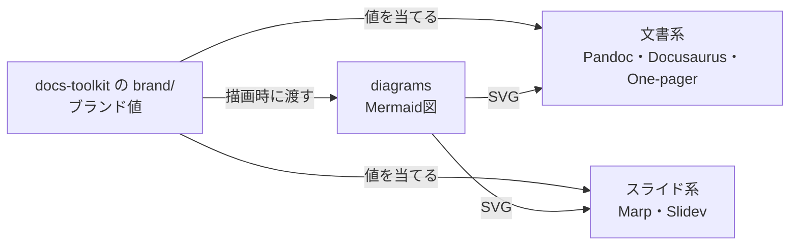

# リポジトリの役割

テンプレートは形式ごとに独立したリポジトリにあり、どれも単独で動きます。docs-toolkit は索引・取り込み方・ブランドの道具だけを持ちます。

docs-toolkit-sample は、これら全部を取り込んでブランドを差し替えた実例です。

| リポジトリ | 役割 | 使いどころ | ガイド |
| --- | --- | --- | --- |
| [pandoc-template](https://github.com/forsteri/pandoc-template) | Markdown から単体HTML / PDF | 配る設計書・手順書・判断記録 | [Pandoc](./guide/pandoc.md) |
| [docusaurus-template](https://github.com/forsteri/docusaurus-template) | 検索付きのドキュメントサイト | 継続して育てる文書群（このサイト） | [Docusaurus](./guide/docusaurus.md) |
| [one-pager](https://github.com/forsteri/one-pager) | 1枚で説明する単体HTML | 変更の説明・概念・構成・比較 | [One-pager](./guide/one-pager.md) |
| [marp-theme](https://github.com/forsteri/marp-theme) | Markdown から PDF のスライド | 報告・提案・発表 | [Marp](./guide/marp.md) |
| [slidev-theme](https://github.com/forsteri/slidev-theme) | 図解部品付きのスライド / SPA | 図の多い発表、ブラウザで見せる資料 | [Slidev](./guide/slidev.md) |
| [diagrams](https://github.com/forsteri/diagrams) | Mermaid から SVG | どの形式にも載せる図 | [図解基盤](./guide/diagrams.md) |
| [docs-toolkit](https://github.com/forsteri/docs-toolkit) | 索引・取り込み方・`brand/`・このサイト | 入口 | — |
| [docs-toolkit-sample](https://github.com/forsteri/docs-toolkit-sample) | 架空の配送追跡API「Hakobi Track」での取り込みの実例 | 動作確認 | — |

## 見た目の2系統

| 系統 | 形式 | 特徴 |
| --- | --- | --- |
| 文書系 | Pandoc・Docusaurus・One-pager・diagrams `neutral` | ニュートラルな面と主色。読むための配色 |
| スライド系 | Marp・Slidev・diagrams `forsteri` | 見出し帯・章扉・系列色・Night（暗い表紙） |

どちらも色とフォントは役割名のトークン（`--dt-accent` など）で書かれていて、値は各テンプレートの `@brand-tokens` ブロックだけにあります。値の差し替えは[ブランドの差し替え](./brand.md)を見てください。
